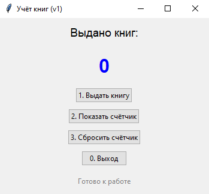
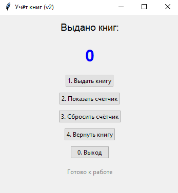
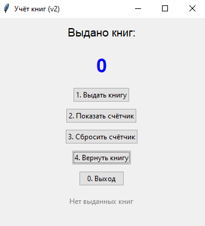

# uchet-knig
Простое графическое приложение (GUI) на Python с использованием библиотеки `tkinter`, которое считает, сколько книг сейчас выдано.
В версии **v1** есть выдача книг, просмотр счётчика, сброс и выход. В версии **v2** добавлена кнопка возврата книги.

## Как запустить

1. Установите Python 3 (библиотека `tkinter` входит в стандартную поставку Python и не требует отдельной установки).
2. Откройте папку проекта в VS Code (или любом другом редакторе).
3. Запустите нужную версию через терминал:

## Скриншоты

### Скриншот 1 — обычная выдача/возврат книги
*(Версия 1 и Версия 2, счётчик равен 0)*

### Скриншот 2 — обработка неверного ввода (возврат при нуле)

